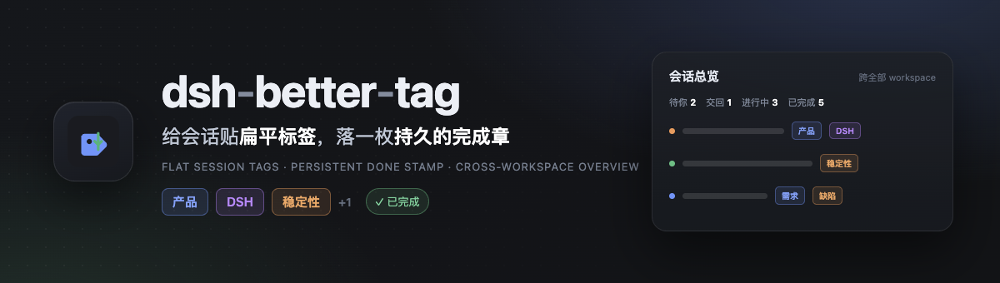
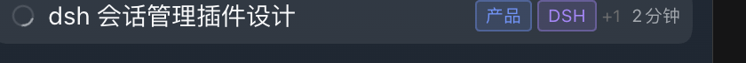
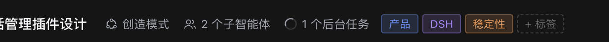
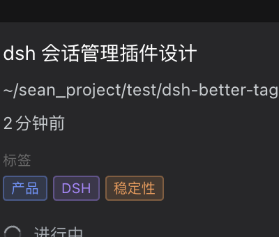

<p align="center">
  
</p>

<h1 align="center">dsh-better-tag</h1>

<p align="center">给 <b>DeepSeek Harness</b> 的会话贴扁平标签，并落一枚持久的「完成」章。</p>

<p align="center">
  <a href="https://www.npmjs.com/package/dsh-better-tag"></a>
  <a href="https://www.npmjs.com/package/dsh-better-tag"></a>
  <a href="https://github.com/Diomchen/dsh-better-tag/actions/workflows/ci.yml"></a>
  <a href="LICENSE"></a>
  
</p>

---

DSH 原生的状态点回答的是「AI 交回了没有」：待你、交回未读、进行中、空闲。它不回答**这件事做完了没有**——因为只有你知道。

`dsh-better-tag` 补上这一层：标签说明这件事**属于什么**，「完成」章说明它**已经收尾**。两者都跟着会话走，重启后还在，发新消息时完成章自动解除。

## 一眼看懂

| 位置 | 你会看到 |
| --- | --- |
| 侧栏行尾 | 最多 2 枚标签 + `+N`，排在时间之前；只读，不抢原生按钮 |
| 行悬停 | 原生 hover 卡片里显示该会话的全部标签与完成章 |
| 行悬停 / `…` 菜单 | ✓ 落章、取消章；「标签…」打开选择器（触屏兜底） |
| 会话标题旁 | 最多 3 枚标签 + `+N`；点芯片或「+ 标签」直接增删 |
| 侧栏「会话总览」 | 跨全部 workspace 平铺：状态计数、标签筛选、归档开关、点行进入会话 |
| 标签选择器 | 勾选/取消、新建标签、管理标签、**临时标签**（不入标签库，随会话持久化） |
| 管理标签 | 改名、改色、删除（级联移除所有引用） |
| 标签包 | 导出 JSON 分享；导入按名字合并，冲突保留本地并报告 |

**不做**：AI 打标、存量批量回填、维度/单选规则、自动归档、多窗口实时推送。

## 截图

**侧栏行尾**：标签排在时间之前，最多 2 枚，多出来的收成 `+N`。



**标题旁**：打开会话后，标签在标题右侧；点芯片或「+ 标签」即可增删。



**悬停卡片**：行悬停时显示全部标签（含临时标签）与完成章。



## 安装

**DSH Desktop**：打开 **Settings → Plugins**，搜索 `dsh-better-tag` 安装，然后刷新页面。

**`dsh web` / 其他 profile**：

```sh
dsh plugin --profile web add dsh-better-tag
# 装完重启 dsh web
```

**直接从 GitHub 安装**（还没发版时）：

```sh
dsh plugin --profile web add github:Diomchen/dsh-better-tag
```

把 `web` 换成你实际的 profile 名。安装后不需要构建：包内是纯 ESM，零运行时依赖。

## 用法

1. **贴标签**：悬停会话行，点「…」→「标签…」；或打开会话，点标题旁的「+ 标签」。
2. **落完成章**：悬停会话行点 ✓，或「…」菜单里选「落完成章」。它会一直留着，直到你发下一条消息或手动取消。
3. **找回来**：点侧栏的「会话总览」，按「待你 / AI 已交回 / 进行中 / 已完成」计数看全局；点标签筛选，勾「显示归档」把归档会话也拉出来。
4. **分享一套标签**：总览 →「导出标签包」；别人「导入标签包」后按名字合并，同名不同色会保留本地颜色并报告冲突。
5. **随手记**：选择器里可以打**临时标签**——不入标签库、跟着这条会话存；常用的话点「固定」收进标签库。

## 它怎么工作

- **Host 半边**把标签与会话记录写成 `~/.dsh/storages/better-tag/state.json`（尊重 `DSH_HOME`），原子写、串行化，不写会话日志、不注册模型工具。
- **Client 半边**通过同源回环接口 `/dsh-better-tag/v1/*` 读写；写入走乐观状态替换，窗口重新可见时重拉。
- **完成章**监听 `api-session/activity`：会话出现新用户消息时自动解除。
- **fork**：子会话继承父会话的标签（含临时标签），不继承完成章。优先包 `sessionController.fork`，并以 `session/created` 事件兜底。

## 数据与隐私

- 数据只在本机：`~/.dsh/storages/better-tag/state.json`（或 `$DSH_HOME/storages/better-tag/state.json`）。
- 回环接口只接受本机请求；所有写请求必须带自定义请求头 `x-better-tag: 1`，跨站页面无法在不触发预检的情况下伪造。
- 不发网络请求、不调用模型、不读会话正文，也不改会话日志。
- 删掉插件不会自动删数据；要清空就删上面那个目录。

## 兼容性

- DSH Web / Desktop **0.2.x**；在 **0.2.2-rc.3**（desktop profile）上开发和验证。
- Node.js **>= 22**；零运行时依赖、无构建步骤。
- 支持中英文界面（跟随 DSH 语言设置）。

## 开发

```sh
npm test        # 17 个宿主测试（store / HTTP / activation）
npm run check   # node --check 全部源文件
npm pack --dry-run   # 看会发出去的包内容
```

发布走 tag：`v*` tag 会触发 GitHub Actions —— 跑测试、建 GitHub Release（附 tarball）、`npm publish`。

## 已知边界

- 侧栏行尾是原生的「悬停即隐藏」装饰位：鼠标停在行上时，标签会让位给操作按钮，这是原生行为。
- 标题旁插槽在窄窗口会被裁切，3 + `+N` 的上限可能需要按你的窗口宽度微调。
- 多窗口不做实时同步，靠窗口重新聚焦时重拉。
- 数据只在本机，不含跨设备 / 多人同步。

## English

**dsh-better-tag** puts flat tags on DeepSeek Harness sessions and adds a persistent *done* stamp that only you can set.

- Tags in the sidebar row (before the timestamp), in the native hover card, and beside the session title.
- A done stamp that survives restarts and clears itself when you send the next message.
- A cross-workspace **session overview** with status counts (needs you / handed back / running / done), tag filters and an archive toggle.
- Temporary per-session tags, named tag packs (JSON export/import), and tag management with cascade delete.

Install with `dsh plugin --profile web add dsh-better-tag` (or from **Settings → Plugins** in DSH Desktop), then restart `dsh web`. Data stays on this machine in `~/.dsh/storages/better-tag/state.json`; the plugin makes no network requests and never writes session logs. Tested on DSH 0.2.2-rc.3, Node.js >= 22, MIT licensed.

## License

[MIT](LICENSE) © 2026 Diomchen
